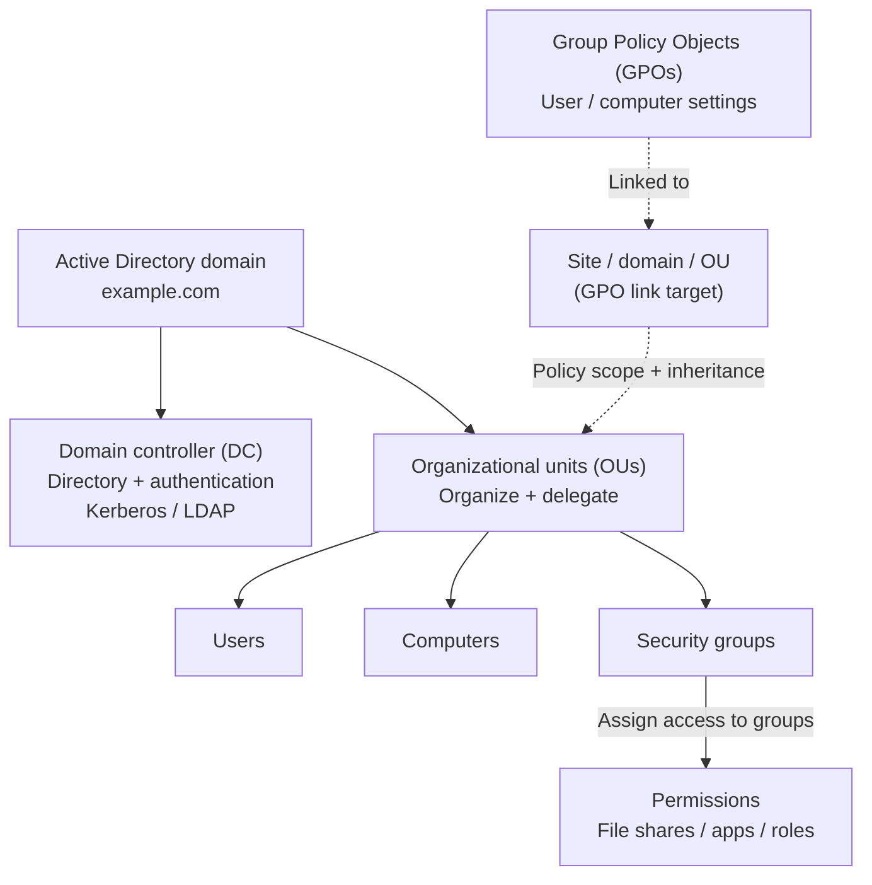

# Active Directory Basics — Visual Quick Reference

> Five-minute reference for junior system administrators, help desk analysts, and IAM learners. Adapted into searchable notes and a GitHub-rendered diagram from the **user-provided “Active Directory Basics — The 5-Minute Diagram for Junior Sysadmins” infographic**.

**Related learning:** [Windows AD / IAM lab](../iam/README.md) · [IAM engineering study plan](../iam/engineering-learning-plan.md) · [Project-Lab home](../../README.md) · [Resource library](cloud-learning-games.md)

## At-a-glance diagram

The following diagram restates the relationships in the shared infographic in a format that renders directly in GitHub Markdown.



*This is a conceptual learning diagram, not a complete AD architecture or a literal representation of all containment, group-membership, or GPO-processing rules.*

## Concepts from the reference image

| Component | Role | Practical administration example |
|---|---|---|
| **AD domain** | Directory namespace that organizes domain identities, computers, and resources | `example.com`; in the current lab, `corp.iamlab.test` |
| **Domain controller (DC)** | Hosts AD Domain Services and supports logon and directory requests (including Kerberos and LDAP) | Verify DNS/DC discovery and sign-in behavior |
| **Organizational units (OUs)** | Organize AD objects, delegate administration and provide targets for GPO links | Separate Servers, Workstations, IT and Finance where useful |
| **Users** | Directory identities representing people or accounts | Create accounts and validate attributes/group membership |
| **Computers** | Domain-joined computer objects | Verify workstation/server OU placement and trust |
| **Groups** | Collect identities to assign access or administrative scope | Grant file-share access to a security group rather than individual users |
| **Permissions** | Determine allowed actions on resources | Use approved SMB share and NTFS permissions for group-based authorization |
| **Group Policy Objects (GPOs)** | Configure managed settings for users and computers | Pilot a workstation policy in a test OU, then check resultant policy |

### GPO scope and inheritance

- GPOs can be **linked to sites, domains and OUs**, with processing and inheritance rules determining applicable policies.
- **Block inheritance** and **Enforced** exist, but should be used deliberately; first check link order, security filtering, WMI filters, loopback (if in use), and resultant policy.
- GPOs primarily configure settings and controls; **security group membership and resource ACLs** are usually what grant access to shares, apps and roles.

## Three common mistakes shown in the image

1. **Keeping everything in default containers:** A purposeful OU structure supports clearer delegation and targeted policy.
2. **Granting permissions to individual users instead of security groups:** Use groups and role-based authorization when suitable, then verify effective permissions.
3. **Linking GPOs everywhere without testing:** Pilot changes in a scoped test OU and validate with `gpresult` and an approved account/device.

**Mnemonic from the infographic:** **“OUs organize, Groups grant, GPOs govern.”**

## Technical clarifications

The source is an introductory mnemonic. For accuracy in a real AD environment:

- The **forest** is generally treated as the main Active Directory security boundary; a domain is a directory namespace and administrative/security-policy scope within a forest.
- Users, computers and group objects can be placed in OUs or other containers. **Group membership is not the same thing as OU containment**.
- Group Policy processing is more nuanced than “GPO applies to everything inside an OU”: security filtering, inheritance, link order, WMI filtering and other rules can change what applies.
- Domain controllers expose several directory and authentication services; **Kerberos** is an authentication protocol, while **LDAP** is a directory access protocol.

## Apply this to the Project-Lab Windows IAM environment

The current lab uses the `corp.iamlab.test` domain with `IAM-DC01`, `IAM-FS01`, and `IAM-CL01`. Relevant portfolio evidence is already organized in the [IAM lab index](../iam/README.md).

A useful continuation is to verify, with **separate non-admin test-user sessions**, how the OU layout, group memberships, GPO settings, and effective SMB/NTFS permissions affect actual access. Record observations and distinguish tests already completed from planned work.

### Safe read-only verification examples

```powershell
# Windows PowerShell on a domain-joined system with the AD RSAT module
Get-ADDomain
Get-ADOrganizationalUnit -Filter * | Select-Object Name,DistinguishedName
Get-ADGroup -Filter * | Select-Object Name,GroupScope,GroupCategory

# Windows Command Prompt (CMD), to review resultant user policy
gpresult /r
```

**Note:** PowerShell AD commands require the appropriate RSAT/AD module and permissions. Avoid publishing live employee identifiers, credentials, or internal network data.

---

**Reference source:** User-shared **“Active Directory Basics — The 5-Minute Diagram for Junior Sysadmins”** graphic. This page is a text-and-Mermaid adaptation for quick future lookup, not a copy of the original image file. The diagram's broad ideas have been supplemented with the technical clarifications above.
